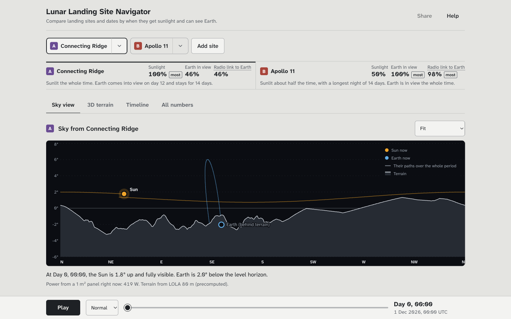

# Lunar Landing Site Navigator

Compare lunar landing sites and dates by where the Sun and Earth sit above the real terrain horizon, so you can see at a glance when a lander has solar power and a direct radio link to Earth.

Built for the NASA Space Apps Challenge 2026, challenge "Lunar Landing Site Navigator".

- **Live app:** `<VERCEL_URL>`
- **API:** `<RENDER_URL>/api/health`



## What it does

At the lunar south pole the Sun circles the sky only a degree or two above the horizon. Earth bobs up and down with the Moon's monthly wobble. A ridge a few hundred metres high, tens of kilometres away, can decide whether a lander has power or can talk to Earth. Moving a few kilometres, or landing a month later, can change everything.

The tool:

- **Compares up to four sites and dates** side by side. Pick curated sites (Artemis III candidate areas, Chang'e-7, IM-2, Apollo, Chandrayaan-3, Chang'e-4 and more), or drop a pin anywhere near the south pole on a zoomable map.
- **Summarises each site in plain words:** sunlight, Earth in view and radio link to Earth as percentages, plus a one-line description.
- **Sky view:** the real 360° skyline from NASA LOLA laser altimetry, with the Sun and Earth paths and their current positions, labelled when hidden behind terrain.
- **3D terrain:** the south pole lit by the real Sun direction at the chosen moment, with live shadows.
- **Timeline:** when there is sunlight, when Earth is in view, and when a radio link is possible over the whole period.
- **All numbers:**
  - countdowns ("Sets in 3 days 4 hours");
  - period totals;
  - power for three solar panel orientations;
  - a CSV download of every time step.
- **Time controls:** play, pause and drag through mission time, with every view kept in sync.
- **Share:** copies a link that reopens exactly the same sites, dates, view and moment.
- **Tutorial:** eight learn-by-doing tasks for first-time visitors, plus a Help panel with a glossary and the methods.

## How it works

| Part | Details |
|---|---|
| Sun and Earth positions | NASA JPL DE440 ephemeris through Skyfield, using the Moon's precise orientation, which includes libration. Checked against JPL Horizons to within 0.004°. |
| Terrain horizon | NASA LRO LOLA south-pole elevation model at 80 m per pixel. 720 lines of sight per site are traced along the curved surface out to 150 km, for an observer 2 m above the ground. Custom spots use a 240 m version. Sites north of 80°S use a smooth sphere. |
| Visibility | Any part of the Sun's disk counts as sunlight. Earth counts as in view when half its disk clears the terrain. There is no atmosphere, so light does not bend. |
| Radio link to Earth (DTE) | Earth in view and a Deep Space Network site (Goldstone, Madrid or Canberra) seeing the Moon at least 10° up. |
| Power | 1,361 W/m² scaled by distance, panel angle and visible share of the Sun. The panel is 1 m² at 30% efficiency. |

Sanity checks that the tests enforce:

- The Shackleton crater floor gets 0% sunlight.
- Chang'e-4 on the far side never sees Earth.
- Connecting Ridge's sunlight changes with the lunar seasons: 100% in December 2026, 45% in March 2027, 38% in June 2027 and 95% in September 2027.

Full detail is in [docs/methodology.md](docs/methodology.md) and in the app's Help panel.

## Run it locally

Backend (Python 3.12+):

```bash
cd backend
python3 -m venv .venv
.venv/bin/pip install -r requirements.txt
.venv/bin/python scripts/download_data.py      # SPICE kernels + LOLA DEM (~150 MB)
.venv/bin/python scripts/build_terrain.py      # only needed if you change the terrain products
.venv/bin/uvicorn app.main:app --port 8000
.venv/bin/pytest -q                             # tests
```

Frontend (Node 20+):

```bash
cd frontend
npm install
npm run dev          # http://localhost:5173, talks to http://localhost:8000
npx vitest run       # tests
```

## Deploy

- **Backend:** Render, Docker, using `render.yaml` (Blueprint) or a Web Service with root `backend`.
  - Set `CORS_ORIGINS` to the frontend URL.
  - Add a free uptime monitor (for example UptimeRobot) on `/api/health` every 5 minutes, so the free server does not fall asleep.
- **Frontend:** Vercel.
  - Root directory: `frontend`.
  - Environment variable: `VITE_API_URL=<RENDER_URL>`.
  - Turn off Deployment Protection so the public can open it.

## Tech

- **Backend:** FastAPI, Skyfield, NumPy.
- **Frontend:** React, TypeScript, Vite, zustand, three.js through react-three-fiber.

## Data sources

- [JPL Horizons](https://ssd.jpl.nasa.gov/horizons/)
- [NAIF SPICE kernels](https://naif.jpl.nasa.gov/naif/data.html)
- [LOLA elevation data, PDS Geosciences Node](https://pds-geosciences.wustl.edu/missions/lro/lola.htm)
- [LROC Quickmap](https://quickmap.lroc.asu.edu/)
- [NASA Moon Trek](https://trek.nasa.gov/moon/)

## Licence

Apache-2.0. See [LICENSE](LICENSE).
